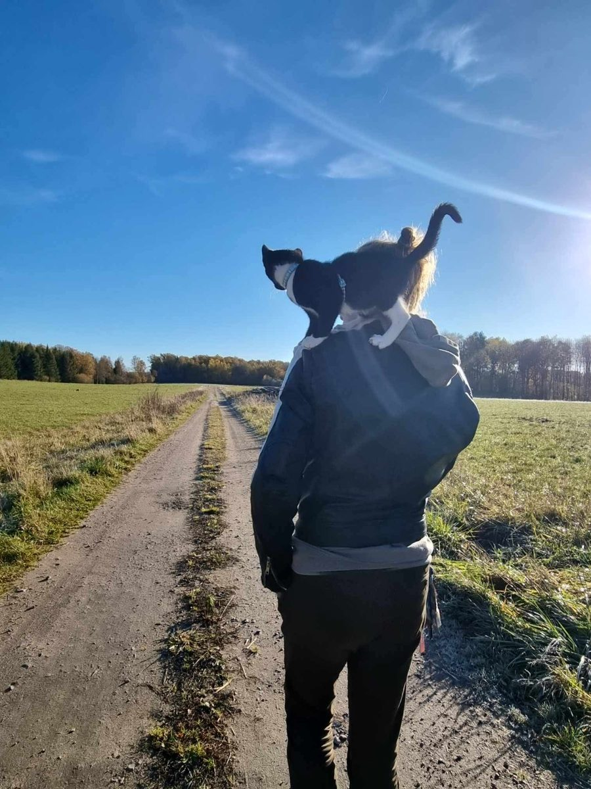

# About the developer

*This page is a stub for now. I will write the full text later.*

## Who I am

*This part is a stub for now too.*

Hi, I'm Alfons. Right now I'm the only developer of FontDaw.

I'm taking a class in music theory and production at the moment. I started in music by playing a variety of brass instruments in primary school. Today I mostly play string instruments: electric bass, double bass and cello. In secondary school I studied IT administration, programming and fashion.
