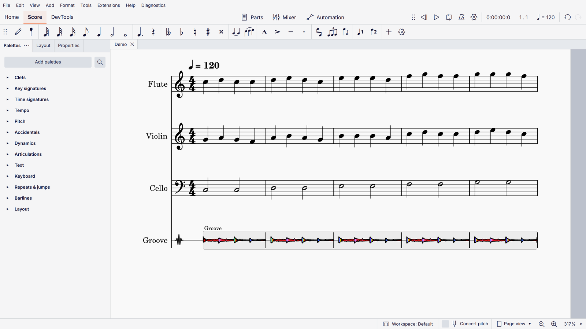
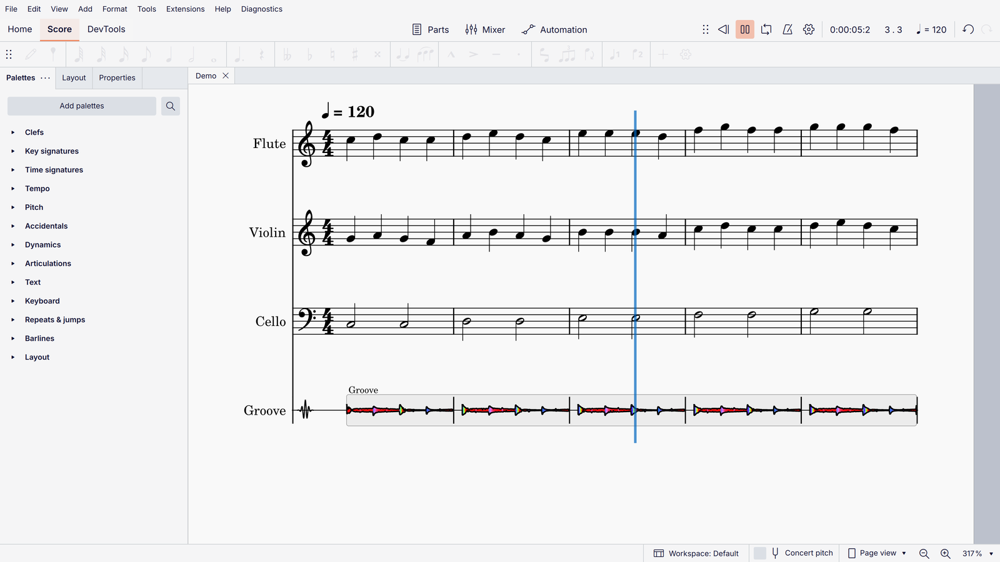
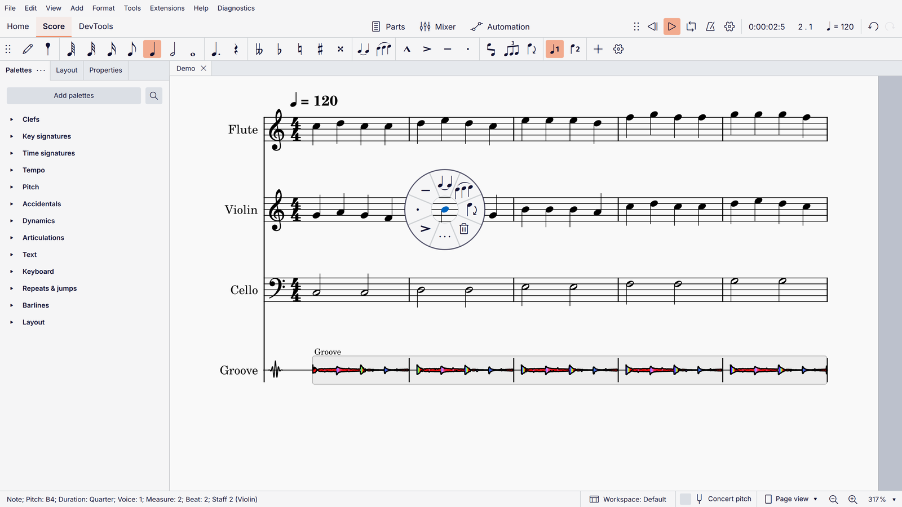

# Dev diary

What we have done on FontDaw, newest first. One entry for a day with notable progress. We write what changed for a user, and what did not work or is still open. Nothing here is a promise.

## 19 November 2026: audio in the score

**Audio is now part of the score.** An audio track shows up in the score as an audio staff with its waveform, in every view and in print, and it plays in step with the notes. Insert or delete bars, and the audio moves with them. Besides WAV, you can now import FLAC, MP3, Ogg Vorbis and Opus files. Undo and redo cover audio edits too, in the same history as the score.

**Quicker commands.** A right-click opens a ring menu around the note. A command menu finds any command when you type its name.

 finds any command by typing part of its name, here “tie”, and shows its keyboard shortcut next to it. Handy when you don't remember where something lives in the menus.")

*These pictures come from a development build, so the top bar shows a DevTools tab and a Diagnostics menu that a released version will not have.*

**Newer foundations.** FontDaw now runs on MuseScore's newest code, including its new shortcut system. MuseScore's current key layout is the default.

**Fixes.**

- Solo is no longer saved as mutes.
- The mixer settings of audio tracks are saved.
- Missing mixer strips are back.
- VST instruments such as VOCALOID now follow the score when you start, stop or jump.
- Quitting after using plug-ins no longer crashes.
- Starting playback in a large score no longer crashes.

**Being designed.**

- A new way of selecting, with a soft glow that shows what a click will act on.
- Articulation maps for sample libraries, so you need no keyswitch notes in the score.
- A Time view where one second always takes the same width.
- Dark score pages, with a separate Print view that shows the printed colours.

**What comes next.** Audio tracks as parts of their own, then moving clips directly in the score.

## 16 November 2026: the first week

**The goal.** FontDaw is meant to become a notation-first DAW. The score stays at the centre of the project. Around it we want audio tracks, recording and mixing, so that you can write music in standard notation and record, arrange and mix audio next to it in one program. Many DAWs treat notation as an extra. Many notation programs treat audio as an extra. We want to start from the score.

**The groundwork.** So far the work is plain groundwork, and not much of it is visible yet:

- The project builds, and its automated tests run and pass.
- A project can now hold audio files on tracks of their own.
- A first audio file plays in time with the score. Use File > Import audio track to put a WAV file on its own track. It has a mixer strip and is included in the exported mixdown. It always starts at the beginning of the score, and you cannot edit it yet.
- Exporting each part of a score to its own audio file got faster, because the parts are now rendered in one pass. On Linux with four cores, a 12-part demo score took 46 seconds before and about 11 seconds now (exported to MP3 with the basic SoundFont). The result is close to the old export but not identical.
- The logos you see are placeholders. They mark the intent, and proper logos will replace them later.

**What comes next.** A plan is written and work has not started. First a timeline that shows the score's parts and the audio tracks side by side, then editing audio clips on it with undo, then more audio formats and safer saving of large projects. After that we expect beat matching and recording. [Status and roadmap](Status-and-roadmap) has the order.
